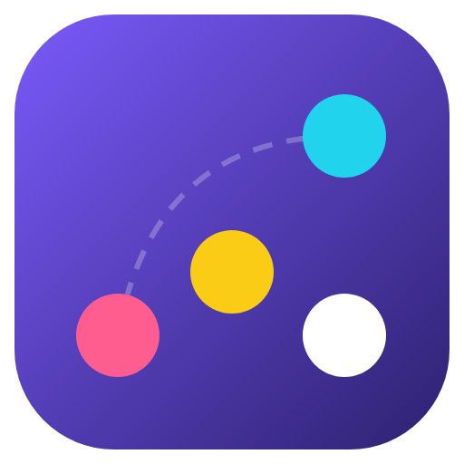

# StageFlow

A desktop app for designing dance formations synced to music. Built with Electron, runs on **Windows** (primary) and **macOS**.



## Features

### Dashboard: sets and segments
- The app opens on a **dashboard** of your **sets** (a show or routine). Each set holds **segments** (one formation timeline each) in running order.
- For each set you see:
  - a **running-order strip** sized by each segment's length, with the total time
  - a card per segment with thumbnails of where everyone **starts** and **ends**
  - a **transition check** between neighbouring segments: the biggest move from one segment's last formation to the next one's first, plus dancers entering or exiting
- Drag segment cards to reorder them, or drop them into another set. You can rename, duplicate or delete segments, and import existing `.stageflow` files.
- A **new segment** continues from the previous one: same dancers and stage, starting where they ended.
- Everything is stored as plain files in `Documents/StageFlow/<Set name>/` (you can change the folder from the dashboard).

### Editor
- **Panels:** a vertical icon rail on the left with **Dancers**, **Arrange**, **Stage**, **Music** and **Choreo**. Click the active icon (or ✕) to fold the panel away. The right **Properties** panel can be closed too, and the title-bar buttons toggle both panels.
- **Arrange (left):**
  - colour palette plus a custom colour picker
  - dancer shapes (circle, square, triangle, diamond, hexagon, star)
  - mirror, line up, space evenly and center tools
- **Stage:** width and depth (feet or meters), columns, rows and subdivisions, and which side the audience is on.
- **Music:** MP3, WAV, OGG, M4A, AAC or FLAC, with a waveform on the timeline. The audio is saved inside the segment file.
- **Time-based timeline (exact seconds):**
  - Each formation block is a striped **movement** part followed by a solid **hold**.
  - Drag the divider (arrival) and the right edge (leaving). Edges snap to the playhead.
  - Type exact times in the Properties panel, or use the pin buttons to set any time to the playhead.
- **Paths:** straight or curved; drag the round handle to shape a curve.
- **3D view:** 2D / 3D / Split. Dancers are jointed human figures that walk between spots. Orbit the camera, then snap back to **Audience**, **Judges**, **Top**, **Side** or your saved **★ My view**.

### Choreo: skeleton from video
- In the **Choreo** tab, load a video of someone dancing (MP4 or WebM). StageFlow tracks their skeleton frame by frame using Google MediaPipe Pose. It runs fully offline because the model ships with the app.
- The result is a **move clip**. Select dancers, put the playhead where the move starts and press **+**. The clip appears on the **Choreo** lane of the timeline, where you can drag it, trim it or mirror it.
- In the 3D view, those dancers perform the move: arms, legs, torso, head and crouch depth are driven by the tracked skeleton, blended smoothly in and out of their walking.

### Export (Export button or Ctrl + E)
- **Video:** plays the segment in real time with its music and records it as MP4 (or WebM), from the 2D stage or the 3D audience camera, at 720p or 1080p. You can record the whole segment or only the current formation.
- **PDF:** one landscape page per formation with the final positions and a call-out table for every dancer (e.g. *SR 4 · DS 2 — 4 ft Stage Right, 2 ft Downstage*).
- **Teach mode:** a separate window that steps through the formations.
  - Each dancer's spot is shown as a large call-out, with where they come from.
  - **Focus on** a single dancer to highlight them.
  - Turn on **Follow main window** to stay in sync with the editor's playhead.
  - Print it for rehearsal.
- **Image:** PNG of the stage as it looks on screen.

## Keyboard shortcuts

| Key | Action |
| --- | --- |
| W A S D | Move selected dancers one grid step (Shift = fine) |
| ← / → | Previous / next formation |
| ↑ / ↓ | Volume up / down |
| Space | Play / pause |
| N | New formation after the current one |
| C | Toggle curved path for selected dancers |
| V | Cycle 2D / 3D / Split view |
| Alt + drag | Move dancers without snapping |
| Shift + drag (timeline) | Drag times without snapping |
| Delete | Remove the selected move clip from the timeline |
| Ctrl + A / Esc | Select all / clear selection |
| Ctrl + Z / Ctrl + Shift + Z | Undo / redo |
| Ctrl + S / E / H | Save / export / dashboard |

## Download / run

### Prebuilt apps
Every push to `main` builds the apps with GitHub Actions. Open the [**Actions** tab](https://github.com/AlexunderscoreM/stageflow/actions), pick the latest run, and download:

- `StageFlow-Windows` contains
  - `StageFlow-Setup-x.y.z.exe`: installer
  - `StageFlow-x.y.z-portable.exe`: a single file that runs with no install
- `StageFlow-macOS` contains a `.dmg`

Pushing a tag like `v0.2.0` also attaches these files to a GitHub Release.

> The builds are not code-signed. On Windows, if SmartScreen warns, click **More info → Run anyway**. On macOS, right-click the app → **Open** the first time.

### From source
Requires [Node.js](https://nodejs.org) 18+.

```bash
npm install
npm start            # run the app
npm run dist:win     # Windows installer + portable exe in dist/
npm run dist:mac     # macOS dmg (run on a Mac)
```

## Project layout

```
main.js          Electron main process: window, app:// protocol, menus, dialogs, library (sets/segments), PDF
preload.js       Safe bridge between the window and the file system
src/index.html   UI layout (dashboard + editor)
src/app.js       Editor: stage, timeline, playback, editing, panels
src/dashboard.js Dashboard: sets, segments, running order, transition check
src/view3d.js    3D view (three.js): stage, human figures, camera presets, pose retargeting, video renderer
src/choreo.js    Choreo tab: video pose analysis (MediaPipe) and move clips
src/export.js    Export: video, PDF, teach mode, PNG
src/teach.html   Teach-mode window (+ teach.js)
src/render2d.js  Canvas renderer shared by exports, teach mode and thumbnails
src/vendor/      three.js and MediaPipe Tasks Vision + pose model (bundled so the app works offline)
```

## Third-party

- [three.js](https://threejs.org) — MIT
- [MediaPipe Tasks Vision](https://github.com/google-ai-edge/mediapipe) and the Pose Landmarker model — Apache 2.0 (see `src/vendor/mediapipe/NOTICE.txt`)
